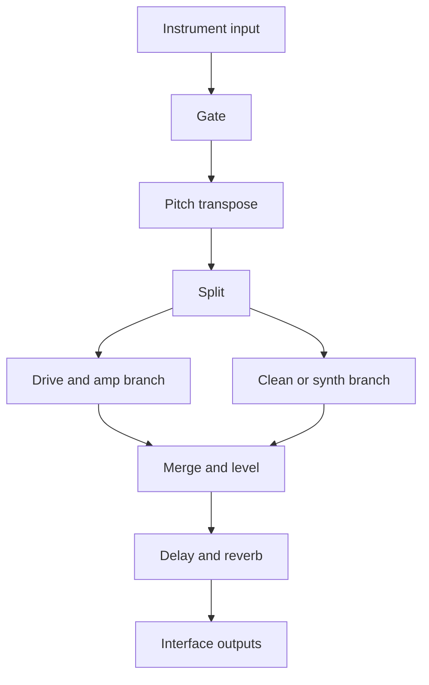

# TabletFX — Full Goal Prompt, UI Specification, and Verification Checklist

**Research date:** 20 November 2026
**Working project name:** TabletFX
**Platforms:** Android tablet/phone, Linux desktop, Windows desktop, and a browser/WASM audition/test client
**Document status:** Researched development specification. Implementation and hardware-test boxes are intentionally unchecked.

## How to use this document

Give this entire document to the coding agent as its goal prompt. It is self-contained: the requirements, visual design, effect backlog, implementation order, evidence rules, and reference sources below are part of the task. The project name is provisional. Build the product in phases; preserve all unfinished requirements in the tracker.

---

# BEGIN GOAL PROMPT

## 1. Mission and priorities

Act as the product designer, real-time audio engineer, DSP integration engineer, Android/Linux developer, and test engineer for TabletFX.

Build a working, offline guitar multi-effects application that turns an ordinary Android tablet or phone, a Linux computer, or a Windows computer into the audio processor. A USB audio interface supplies the instrument input, analog-to-digital conversion, digital-to-analog conversion, and headphone/line outputs. The app must process the incoming guitar itself.

Also provide a browser/WASM audition and test client using the shared DSP implementation. It must load local guitar audio without uploading it, then play the selected effect chain's processed result through the browser when Play is pressed. The client supplements native targets and does not establish native hardware latency or device compatibility.

The practical goal is to reduce the need to buy an expensive dedicated multi-FX processor. Provide a configuration experience closely resembling the useful interaction patterns of Melofty Axom Max, Line 6 HX Edit/Helix, HeadRush, BOSS Tone Studio, Zoom, Valeton, and Fender Tone Master Pro: visible blocks, drag-and-drop order, parameter editing, routing, reusable presets, and performance controls. Use original branding, artwork, icons, and implementation.

Reuse existing open-source DSP as extensively as possible. Prefer adapting a mature algorithm and improving its control surface over writing a new approximation. Treat the commercial products as references for capabilities and workflows; their algorithms and proprietary preset formats are not supplied by those references.

### User priorities

1. Convincing live guitar processing, especially polyphonic pitch shifting of chords at **−6 and +6 semitones**.
2. Saving the entire sound, including pitch settings, as a preset that survives restarting the app and transfers between Android and Linux.
3. A clear, touch-friendly, commercial-style drag-and-drop editor.
4. Broad creative effects: modulation, delay, reverb, filters, guitar synth, and eventually vocoder/harmony.
5. Reliable USB input/output, stable performance, low measured latency, and affordable hardware.
6. Amp/cabinet simulation, IRs, and open neural model formats as part of the complete product, without delaying the early pitch/effects feasibility work.

Do not treat a moving meter, a rendered block, a menu entry, or an offline WAV transform as proof of working live processing.

## 2. Target hardware and feasibility boundary

The primary Android target is the user's **itel VistaTab 11**. Official specifications identify a T615 processor, Android 14, a 10.1-inch screen, and 4 GB physical RAM with 8 GB memory expansion. Budget against physical RAM. Check the actual device ABI, build fingerprint, available memory, USB routing, supported sample rates, and audio capabilities before choosing binary targets or claiming compatibility. [H1]

Target Android ARM64 where the installed OS supports it; verify whether another ABI is needed. Target Linux x86_64, including the user's Pop!_OS 22.04 environment, with a reproducible build on a compatible baseline. Treat other Android devices and Linux ARM64 as additional tested configurations, not implied support.

Record what is observed on the actual device rather than inferring audio performance from the CPU name. Android documents substantial latency differences between models and builds. [H2]

### Physical connection

Guitar → instrument/Hi-Z input of a suitable USB audio interface → USB host connection to Android or Linux → TabletFX → the same interface's headphone/line outputs.

Use one interface for full-duplex input/output initially. Provide channel selection and input-gain guidance. Test power requirements, USB host operation, and any charging hub as part of the actual configuration. A passive jack adapter is not a replacement for a suitable instrument interface.

Do not include external pedals, external DSP processors, a remote computer, or cloud processing in the required Android signal path. Linux is an independent host option. USB/Bluetooth MIDI controllers may operate switches and expression controls; that is separate from the audio route.

### Early decision gate

Before extensive UI polish, build and measure:

- Live dry monitoring through the selected interface.
- A simple gain/gate/drive/delay chain.
- Two or more source-audited pitch candidates at −6/+6 semitones, 100% wet, using real guitar chords.
- The same tests during sustained operation on the itel.

If the device/route or available algorithms cannot meet the live target, report the measurements and cause. Continue the achievable effects work, retain the failed requirement, and label the affected configuration experimental or practice-only. Do not silently redefine success or claim commercial hardware parity.

## 3. Research and source audit before implementation

Create `RESEARCH.md` with official manuals, software/firmware versions, relevant page/section numbers, research date, and what each source actually establishes. Preserve distinctions between a hardware touchscreen and its desktop editor.

Use the reference matrix and bibliography in this document as a starting point. Recheck changing dependencies when implementation starts.

Audit Amp Rack at:

- Repository: https://github.com/djshaji/amp-rack
- Inspected public commit: `345b961636d0725bb267fb0012859c7c75ff9d63`
- Host/native sources: `app/src/main/cpp/`
- Bundled native libraries: `app/src/main/jniLibs/`
- LV2 metadata/preset assets: `app/src/main/assets/lv2/`
- Desktop counterpart linked by the README: https://github.com/djshaji/alana

The audit found host source, some effect source, and many prebuilt effect libraries. Examples of included source are `amp.cpp`, `crybabyx.cpp`, `distortionx.cpp`, and `tubex.cpp` in their respective modules. The inspected app Gradle file comments out those four module dependencies. Source presence alone does not establish active build integration.

Pitch libraries such as `libtap_pitch.so` and `libam_pitchshift_1433.so` occur under `jniLibs`; matching complete pitch implementations were not found in the inspected recursive source tree. Retrieve and build their upstream sources before integrating them.

The root Apache-2.0 license is not a blanket license for all contained effects: `tubex.cpp` declares GPL-2.0-or-later and the inspected `crybabyx.cpp` header says GPL without resolving its exact version. Audit each reused component. Amp Rack's FAQ documents saving plugin parameters and order, which is useful precedent for portable presets. [R1–R6]

Make an architecture decision record comparing:

- Reusing selected Amp Rack host concepts.
- Reusing or adapting its desktop counterpart.
- A new shared core with audited upstream DSP.

Choose on build reproducibility, real-time behavior, licensing, Android/Linux portability, and maintainability. Do not copy an entire application merely because its repository is available.

## 4. Product architecture

### Default direction

Use a shared **C++20 audio/DSP core**, **Qt 6 Quick/QML** for the native cross-platform interface, **Oboe** for Android audio, and a **JACK-compatible backend** on Linux that can operate with JACK or an appropriately configured PipeWire JACK layer. Add a native PipeWire or ALSA backend only where it solves a demonstrated compatibility need.

Keep the audio backend behind an interface and build the headless DSP runner without Qt. Use a small Android platform bridge for lifecycle, permissions, device events, foreground audio operation, storage access, and MIDI.

This is a proposed architecture, not a measured performance claim. Validate Qt's selected release, Android SDK/NDK support, Linux baseline, packaging, startup cost, memory, and rendering load in the first vertical slice. If that choice fails a concrete requirement, document the evidence and substitute a suitable native UI without rewriting the DSP core.

Use CMake, pinned dependencies, reproducible toolchains, and a documented dependency lock/manifest. Start with bundled, audited processors. Optional Linux LV2 hosting comes after the shared built-in library works.

### License direction

Use a GPLv3-compatible open-source distribution strategy for the new application, preserving each upstream component's exact license and notices. Verify compatibility for the actual linked files, wrappers, and dependencies before adoption.

Do not automatically include GPL-2.0-only files, unknown-license snippets, proprietary binaries, or models/IRs with no redistribution permission. A code license does not grant rights to every capture, impulse response, demo recording, preset artwork, or model weight.

Do not assume JUCE is permissively licensed. The inspected current JUCE license offers AGPLv3 or commercial terms. Qt also requires a module-specific license check. Record the final decision instead of mixing incompatible components. [D12–D14]

### Audio engine contract

- Real audio callback processing in native code.
- Float32 internal buffers by default; use higher precision where an algorithm needs it.
- Separate audio, control/UI, loading, and recording work.
- No heap allocation/deallocation, locks, waits, file/network I/O, logging, graph rebuilding, model parsing, or GUI calls in the real-time callback.
- Preallocate scratch buffers and bounded event queues for a negotiated maximum block size.
- Account for variable callback sizes; use bounded adapters for processors requiring a fixed internal block.
- Build and validate graph changes on a worker; activate prepared state at a block boundary.
- Use safe deferred destruction. An atomic pointer exchange is insufficient if the callback destroys the old graph.
- Deliver parameter/MIDI events through bounded queues; define queue-overflow handling, smoothing, timestamp semantics, and ordering.
- Apply parameter smoothing where appropriate; do not smooth switches, notes, or tempo in ways that change their meaning.
- Preload and prewarm IRs/models off the audio thread.
- Handle denormals, non-finite output, and invalid parameter values without an unbounded recovery path.
- Verify any SIMD optimization on supported ARM/x86 targets against a scalar reference with justified tolerances.
- Keep a known-good graph active if a replacement fails validation or cannot fit the resource budget.

### Android audio

Request the appropriate low-latency Oboe path; try exclusive mode when available and handle a shared-mode fallback. Inspect the route actually granted. Negotiate the device's natural sample rate and report the result. Start with 48 kHz as a preferred configuration only where the route supports it. Avoid accidental platform resampling. Do not force voice processing on a guitar input; request a suitable unprocessed input configuration when supported and document fallbacks. [H2–H3]

Tune buffers from observed bursts and underruns. Test practical buffer sizes supported by the route rather than assuming a requested 64-frame buffer is honored. Handle permission denial, audio focus, microphone privacy controls, USB detach/reattach, foreground operation, interruptions, and screen lifecycle using current Android rules.

On interface loss, mute and show a recoverable state. Do not unexpectedly reroute a guitar-monitoring session to the tablet microphone and speakers. Reopen streams off the callback.

Follow Oboe's full-duplex/LiveEffect pattern: open output first, align input to the obtained output rate, synchronize startup, handle partial input reads, and recover both streams together. Qt's Android thread can suspend when the Activity stops, so the service/native engine must own audio independently of the QML event loop. Start microphone capture from a visible Activity after permission is granted, declare the appropriate foreground-service type/permission, and test screen lock and Activity recreation. [H4, H7, D15]

### Linux audio

Expose actual input/output ports, sample rate, quantum/buffer size, and xrun counts where supported. Recover gracefully from server restarts and changing routes. Document the tested PipeWire/JACK setup. Do not silently change system-wide audio settings or require root.

### Shared processor adapter

Every processor must expose a stable ID, version, origin, license, category, supported channel layouts, parameters and units, state serialization, required assets, reported latency, tail behavior, quality modes, supported sample rates, automation behavior, and resource estimates.

Unsupported plugins must not masquerade as working blocks. On Android, build native code for the device ABI with its dependencies. A Linux .so or Windows VST DLL is not automatically usable on Android. Do not promise arbitrary desktop plugin compatibility.

## 5. UI design specification

### Visual direction

Create a professional dark interface with clear signal routing, compact information hierarchy, and large touch targets. Aim for the familiarity of HX Edit's chain view combined with HeadRush/Fender/Melofty touch interactions.

Use original flat block graphics. Reserve decorative pedal illustrations for optional details; the main editor must prioritize routing and editing.

Proposed tokens:

| Token | Proposed value |
|---|---|
| App background | `#10141B` |
| Raised panel | `#1B2330` |
| Main text | `#F1F5F9` |
| Secondary text | `#AAB6C7` |
| Focus/selection | `#5DD9C1` |
| Drive family | Orange `#F59E63` |
| Dynamics/EQ | Cyan `#63C5DA` |
| Modulation | Purple `#B89AF7` |
| Delay | Blue `#79ACFF` |
| Reverb | Green `#75D3A2` |
| Pitch/synth | Rose `#F28BB5` |
| Warning/error | Amber/red plus text/icon |
| Spacing | 8 dp base; 16 dp panel padding |
| Touch controls | At least 48 dp target where practical |
| Typography | Readable sans-serif; tabular numbers for measurements |

These are proposed values; validate contrast, color-vision accessibility, and daylight readability. Color must never be the only identifier of family, bypass, error, or selection.

### Navigation

Provide **Edit**, **Perform**, **Presets**, **Practice**, and **Settings**. Tuner, panic/mute, and audio connection status remain quickly accessible.

### Tablet and desktop editor

Use a 1280×1024, 5:4 reference artboard for design review. Adapt to the actual device viewport; the product is resizable, not locked to that aspect ratio.

| Region | Layout and behavior |
|---|---|
| Header, roughly 64 dp | Preset name/bank, dirty marker, undo/redo, save, tuner, transport/audio status, settings |
| Left browser, roughly 224 dp when space allows | Search, category tabs, favorites, recently used, lightweight/live filters, model/effect cards |
| Central canvas | Left-to-right audio blocks, visible ports and connectors, two lanes initially, explicit split/merge nodes, pan/zoom and fit-to-chain |
| Inspector below canvas | Selected block title, enabled state, model selector, editable parameters, expression/MIDI assignment, source/info disclosure |
| Scene strip | Eight named scene slots as a product target; active/modified/assigned state clearly visible |
| Bottom performance strip | Assignable virtual switches with names, colors, momentary/latch indicators, tap tempo and tuner access |
| Status area | Input/output peaks, clipping, DSP callback load, xruns, route/sample rate, latency status |

Show enough of the chain to understand the sound while keeping controls usable. Expanding the inspector should preserve a compact chain overview. Collapse the browser rather than shrinking every control on smaller tablets.

### Block design

Each block shows its category icon, user-visible name, model or mode, enable state, selection state, mono/stereo port information, and assignment indicator. Display estimated cost or unsupported-state warnings where useful. Keep full technical metadata in an information sheet.

Single tap selects. Double tap opens a focused editor where available. Provide a dedicated bypass control rather than making ordinary selection toggle sound.

### Drag-and-drop behavior

- Drag a browser item onto a gap to insert; display the precise target and route before dropping.
- Drag an existing block to reorder or move between valid lanes.
- Dragging over an occupied block must distinguish insert from replace. Replacement must not be an accidental default.
- Use visible drag ghosts, insertion highlights, snapping, autoscroll, and invalid-target feedback.
- Support duplicate, copy/paste, delete, replace model, group/favorite chain, and undo/redo.
- A completed drag is one undoable transaction.
- Provide touch-friendly Move Before/After/To Lane actions and keyboard alternatives.
- Define long-press versus scroll arbitration; a scrolling gesture must not unexpectedly rearrange a live rig.
- Validate the graph and resource budget before committing.
- Preserve the current sound if an edit fails; show the cause next to the attempted action.

### Routing

Support serial chains and explicit two-way splits/merges first. Add additional lanes after resource and usability tests.

Support A/B switching, parallel blend, crossover routing, branch gain/pan, and phase inversion as separate controls. Mono/stereo conversion must be explicit and tested. Mixer gains must be visible; parallel routes can sum above unity.

The diagram below describes a routing capability, not a mandatory preset:



Track per-node algorithmic latency and align parallel branches where feasible. Explain that compensation delays the faster branch and can increase live latency. Do not confuse frequency-dependent phase response with a single fixed delay. Reject arbitrary graph cycles; feedback belongs inside a purpose-built, bounded feedback/delay processor.

### Inspector

Use labeled knobs/sliders with units, precise numeric entry, reset-to-default, fine adjustment, tempo subdivisions, ranges, and contextual help. Show key/scale only where the processor uses them. Allow one expression source to control multiple parameters with per-parameter range, curve, inversion, and smoothing.

Simple and advanced pages may share one engine. Presets must retain hidden advanced settings. Parameter changes must reach audible DSP rather than merely update the displayed value.

### Phone layout

Use a 1024×1280, 4:5 reference artboard for compact design review, then test actual phone sizes. Offer a vertically scrollable chain or compact lane overview, a full-width parameter sheet, collapsible effects browser, and a four-switch bank. Preserve the same graph/preset format. Rotate without losing edits or disturbing audio.

### Perform mode

Use large switches and scene labels, clear preset navigation, tuner/mute, tap tempo, and minimal meters. Lock graph editing against accidental touches. Allow a USB MIDI foot controller or expression pedal through a supported MIDI interface. Do not require a proprietary controller.

Provide explicit switch assignment pages for bypass, multiple-block toggles, scenes, next/previous preset, tap, tuner, looper, and momentary actions.

### Audio setup screen

Show detected devices, input/output channels, actual sample rate, supported buffer controls, input/output meters, live-monitor state, and a simple setup test. Explain the interface's direct-monitor control separately from app monitoring so users do not accidentally blend dry hardware monitoring with transposed audio.

Show three distinct latency concepts: buffering estimate, processor-reported delay, and measured end-to-end latency. Never label a buffer calculation as a measured round trip. Invalidate or mark measurements stale when the device, route, graph, or relevant quality setting changes.

### Accessibility and design acceptance

Support keyboard focus/order, screen-reader labels, high contrast, readable scaling, reduced motion, and touch alternatives to drag. Meter animation should not burden the audio thread. If design-review images are generated, use 1:1, 5:4, or 4:5 crops and inspect all text for language, spelling, and factual correctness.

## 6. Presets, scenes, and portability

A preset stores the complete graph, stable processor IDs/versions, parameter values, enabled states, routing, mixer state, tempo, controller assignments, quality choices, assets, and scene definitions. Persist the actual algorithm/backend identity and a versioned quality profile or explicit window/hop settings. A generic pitch block must not silently choose different algorithms on Android and Linux. Missing backends require a visible compatibility decision.

A scene changes declared bypass/parameter/controller state within a prepared graph. Distinguish global values, preset values, and per-scene overrides in the UI. Treat major algorithm/model swaps as graph changes unless they have a separately verified preloaded transition mechanism.

Implement:

- Local save/save-as/rename/duplicate/delete, favorites, tags, search, banks, and setlists.
- Dirty state, unsaved-change recovery, autosave draft, explicit saved version, undo/redo.
- Eight scene slots as an initial target; expand only where usability and resources justify it.
- Scene names, optional tempo override, parameter assignments, and configurable switching behavior.
- Block presets and reusable chain fragments.
- Portable export bundles with JSON manifest, permitted assets, checksums, license/origin data, and missing-asset reports.
- Schema validation, migrations, atomic writes, backup/recovery, and deterministic import behavior.
- Safe handling of unknown processors, future schema versions, oversized bundles, malformed JSON, and archive path traversal.
- Cross-platform reloading without Android/Linux absolute-path dependencies.
- Reproducible randomness where required for tests; explicit state policy for stochastic effects and oscillators.

Delay/reverb tails and gapless switching are separate acceptance requirements. Same-graph scene transitions should preserve relevant state. Whole-preset changes may require preloading/crossfading with extra CPU and memory. Report gaps, ramps, or tail limits truthfully if a configuration cannot sustain both graphs.

### Schema outline

Define and validate a real schema before treating this as production data:

```json
{
  "schemaVersion": 1,
  "presetId": "stable-uuid",
  "name": "Six Down Rhythm",
  "tempo": {"bpm": 120, "source": "preset"},
  "nodes": [
    {
      "id": "pitch-1",
      "processor": "tabletfx.pitch.poly",
      "processorVersion": "pinned-adapter-version",
      "backend": {"id": "selected-engine", "version": "pinned-version", "profileVersion": 1},
      "params": {"semitones": -6, "mix": 1.0},
      "bypassed": false,
      "qualityMode": "live"
    }
  ],
  "connections": [],
  "scenes": [
    {
      "id": "scene-1",
      "name": "Six Down",
      "overrides": {"pitch-1": {"params": {"semitones": -6}}}
    },
    {
      "id": "scene-2",
      "name": "Six Up",
      "overrides": {"pitch-1": {"params": {"semitones": 6}}}
    }
  ],
  "controllerMappings": [],
  "assets": []
}
```

This is a partial schema example, not an audible complete preset: production data must include valid input/output nodes and connections. Stable IDs above are proposed application IDs, not existing upstream plugin identifiers.

## 7. Pitch, harmony, and synth feasibility

Keep these capabilities distinct:

| Capability | Meaning and required evidence |
|---|---|
| Polyphonic transpose/drop/capo | Shift all notes of a chord together while preserving duration; prioritize −6/+6 |
| Monophonic pitch | Single-note tracking/processing; document limits on chords |
| Harmonizer | Additional musical voices; document whether fixed interval or key/scale-aware |
| Whammy/pedal bend | Continuous expression-controlled ratio and smoothing; specify mono/poly behavior |
| Detune/doubler | Small pitch offsets, stereo treatment, optional delay |
| Vocal correction | Detect and correct sung notes; does not imply guitar chord transposition |
| Guitar synth | Audio transformation or pitch-tracked synthesis; identify which |
| Guitar-to-MIDI | Note/event extraction with onset, release, bend, and tracking limitations |
| Vocoder | Modulator/carrier processing and routing; requires a carrier source |
| Frequency shifter | Additive frequency offset in Hz; not musical semitone transposition |

A mono audio input can contain many simultaneous notes. Channel count and note polyphony are different properties.

### Candidate evaluation

Benchmark Signalsmith Stretch with explicitly tuned windows/intervals as an initial permissive candidate. Its reviewed presets use long analysis blocks; do not call the defaults pedal-like low latency. Query and measure its input/output latency. Compare suitable audited time-domain and other pitch implementations, including TAP/SWH candidates as quality baselines.

Rubber Band LiveShifter documents 50 ms or more input-to-output delay depending on configuration. SoundTouch also has substantial latency in common configurations. They may serve practice/offline processing or a clearly labeled high-quality mode, but cannot be assumed to satisfy live-guitar targets. RubberBandStretcher R2 Short may be benchmarked separately; its start-delay report is not total physical live latency. [D1–D4]

Changing a sample-playback speed alone changes duration and is not an acceptable live transposer. A generic frequency shifter is not a substitute. A pitch detector feeding an oscillator is not a transparent polyphonic guitar transposer.

### Mandatory pitch acceptance work

- Test −12, −7, **−6**, −5, −2, −1, 0, +1, +2, +5, **+6**, +7, +12; test wider advertised ranges separately.
- Test 100% wet operation with no unintended dry leakage.
- Include low E, lower tunings used by the player, open major/minor chords, barre chords, power chords, intervals, fast strumming, palm-muted attacks, bends, vibrato, harmonics, slides, and decaying notes.
- Compare clean input, driven input, and placing the transposer before drive. Do not conflate input distortion with shifter artifacts.
- Measure actual algorithmic and total latency, pitch accuracy, transient smearing, dropouts, warble, modulation artifacts, stereo behavior, CPU, and memory.
- Use steady sine tests with a proposed ±5-cent accuracy target after settling; this does not substitute for chord listening tests.
- Capture level-matched audio examples with retained settings and reproducible source recordings.
- Obtain human listening evidence for the advertised chord use case; use reference hardware only when physically available and actually measured.
- Persist semitones, quality mode, wet/dry, fine tuning, and expression mappings in presets/scenes.
- Distinguish an available experimental algorithm from a verified live preset.

### Proposed live-performance targets

These are product acceptance targets, not measured specifications for the itel:

| Metric | Proposed target and reporting rule |
|---|---|
| Electrical round trip, dry/basic chain | Aim ≤15 ms; provisional live acceptance ≤20 ms on the exact tested route |
| Electrical round trip with advertised live transpose | ≤20 ms plus acceptable chord quality; otherwise mark this feature's live gate failed |
| Callback budget | At least 30% headroom at the 99th percentile under the supported reference chain |
| Sustained operation | 60 minutes with zero observed xruns/audio dropouts at the advertised configuration |
| UI while playing | No additional xruns during dragging, browsing, scene switching, or saving |
| Scene response | No unintended mute/pop; record event-to-audio delay and any intentional ramp |
| Memory/thermal behavior | Bounded memory after warmup; no progressive leak or thermal-induced audio failure |

Report medians, percentiles, worst observations, test duration, route, interface, OS, sample rate, graph, algorithm settings, and measurement method. Do not infer a total round trip from one buffer or subtract algorithm delay from the number shown to the player. If a target is missed, keep the failure visible and investigate its source.

## 8. Open-source implementation strategy

Select components according to the detailed source matrix below. Every adopted component needs a pinned revision, license record, build recipe, parameter adapter, automated DSP checks, and target-device evidence.

Start with:

- Small original utility processors for gain, routing, mixing, meters, and explicit channel conversion.
- Audited Guitarix/GxPlugins, LSP, Airwindows, CHOW, and selected LADSPA/LV2 sources for conventional DSP.
- A replaceable pitch-engine adapter so candidates can be compared without rewriting UI/presets.
- NAM core and AIDA-X-compatible processing as separate optional model backends.
- An audited convolution engine for cabinet IRs; consider algorithmic cabinet filters for lighter presets.
- Audio-driven synth/filter effects before claiming reliable polyphonic guitar-to-MIDI.
- Linux plugin hosting only after consistent built-in Android/Linux effects work.

Do not present every algorithm variant as a new engine if it is only a factory preset. Conversely, do not collapse materially different functions—such as pitch shifting and frequency shifting—into one misleading block.

Keep classic algorithmic amp/drive models, neural captures, cabinet IRs, and mic positioning controls separate. Do not add fictional editable circuit controls to a static capture and imply they alter the captured amplifier's original internals.

NAM model files can carry sample-rate and calibration metadata; honor the model's actual supported behavior. Load/validate/prewarm off the callback. AIDA-X, NAM, RTNeural, and GuitarML model files are not automatically interchangeable. [D8–D10]

## 9. Requirements tracking rules

Use the effect catalog and platform checklists below as the initial backlog.

For every item create a tracker row:

`ID | Priority | Requirement | Upstream/commit/license | Implementation | Automated tests | Device/listening verification | Evidence | Remaining limitation`

Use separate states for **not started**, **in progress**, **implemented**, **tested**, **verified**, **blocked**, and **deferred to a named phase**. A completion checkbox is checked only when implementation, relevant automated tests, and required real-device/listening verification all pass.

Priority meanings:

- **P0:** first usable release requirements and feasibility gates.
- **P1:** complete everyday multi-FX product.
- **P2:** advanced capabilities in the full goal; retain them in later milestones with explicit dependencies.

P2 is an implementation sequence, not permission to forget the requirement. A release may complete P0 without completing the full product goal. Report those statuses separately.

Catalog entries represent normalized capabilities. Multiple entries may share one processor with distinct modes; some require multiple processors. Do not claim this is a verbatim complete inventory of every model, firmware, or proprietary algorithm sold by the reference brands.

## 10. Effect capability checklist

Each box follows the implementation/test/device-verification rule in section 9. These are original normalized requirements derived from the reference families, not copied proprietary model lists. A named style is a tonal/function target, not a claim of exact circuit or sound equivalence. All effects must meet the universal processor tests in section 12.

### 10.1 Utilities, routing, and level

Reference coverage: general chain/routing/utility functions across Helix, BOSS, HeadRush, Zoom, Fender, and TONEX. [C1–C8, C11–C19]

- [ ] **UTL-01 · P0** Input trim and output gain, with units and smooth changes.
- [ ] **UTL-02 · P0** Volume pedal, selectable position, expression curve and endpoints.
- [ ] **UTL-03 · P0** Independent block bypass, global bypass, input mute, and panic mute.
- [ ] **UTL-04 · P0** Mono/stereo conversion with explicit summing policy.
- [ ] **UTL-05 · P0** Splitter, parallel mixer, branch gains, pan/balance, and phase inversion.
- [ ] **UTL-06 · P1** A/B route switching and crossfade.
- [ ] **UTL-07 · P1** Frequency-crossover and level/envelope-dependent split.
- [ ] **UTL-08 · P0** Input/output peak/RMS meters, clip indication, and per-block diagnostics.
- [ ] **UTL-09 · P0** Chromatic tuner, adjustable reference, muted and audible modes.
- [ ] **UTL-10 · P1** Global output EQ and selectable destination profiles.
- [ ] **UTL-11 · P1** Delay alignment/sample delay for branches and external routes.
- [ ] **UTL-12 · P2** External send/return only when the interface exposes sufficient I/O; measure its extra latency.
- [ ] **UTL-13 · P1** Mid/side and stereo-width utility with mono-compatibility checks.
- [ ] **UTL-14 · P0** Configurable output protection and controlled mute/unmute ramps.

### 10.2 Dynamics and noise control

Reference coverage: BOSS/Zoom dynamics, HeadRush compression and sustain, Fender dynamics, TONEX compressor/gate. [C4, C7, C11, C14, C19]

- [ ] **DYN-01 · P0** Noise gate with threshold, hysteresis, attack, hold, release.
- [ ] **DYN-02 · P1** Fast hard gate for high-gain rhythms.
- [ ] **DYN-03 · P1** Downward expander for gentler noise control.
- [ ] **DYN-04 · P2** Adaptive noise reduction with declared latency and guitar-tail preservation tests.
- [ ] **DYN-05 · P0** Guitar pedal compressor with sensitivity, sustain, attack, level.
- [ ] **DYN-06 · P1** Studio compressor with threshold, ratio, knee, attack, release, makeup.
- [ ] **DYN-07 · P1** Optical-style compression.
- [ ] **DYN-08 · P1** FET-style compression.
- [ ] **DYN-09 · P1** Parallel compression with time-aligned dry blend.
- [ ] **DYN-10 · P2** Multiband compression with crossover/recombination tests.
- [ ] **DYN-11 · P0** Peak limiter; document any lookahead latency.
- [ ] **DYN-12 · P1** Transient shaper for attack and sustain.
- [ ] **DYN-13 · P1** Automatic swell/slow attack with retrigger control.
- [ ] **DYN-14 · P1** Sustain enhancement, distinguished from a frozen audio buffer.
- [ ] **DYN-15 · P1** Sidechain/envelope ducking.
- [ ] **DYN-16 · P2** De-esser for a separately enabled vocal path.

### 10.3 EQ, wah, and filters

Reference coverage: Helix/BOSS/Zoom filtering, HeadRush EQ/filter, Fender EQ and filter families, TONEX EQ/wah. [C2, C4, C7, C11, C14, C19]

- [ ] **EQF-01 · P0** Low-cut/high-pass and high-cut/low-pass filters.
- [ ] **EQF-02 · P0** Three/five-band parametric EQ with frequency, gain, Q.
- [ ] **EQF-03 · P1** Guitar graphic EQ with selectable band layouts.
- [ ] **EQF-04 · P1** Bass graphic EQ with appropriate frequency coverage.
- [ ] **EQF-05 · P1** Shelving and tilt EQ.
- [ ] **EQF-06 · P1** Notch filter for narrow problem frequencies.
- [ ] **EQF-07 · P2** Dynamic EQ.
- [ ] **EQF-08 · P0** Pedal wah with range, resonance, position, and level.
- [ ] **EQF-09 · P1** Multiple audited wah voicings, including bass wah.
- [ ] **EQF-10 · P0** Envelope/touch wah with sensitivity and up/down sweep.
- [ ] **EQF-11 · P1** LFO auto-wah.
- [ ] **EQF-12 · P1** Resonant low/band/high-pass filter with envelope/LFO control.
- [ ] **EQF-13 · P1** Vowel/formant filter and humanizer-style movement.
- [ ] **EQF-14 · P1** Step/sequenced filter.
- [ ] **EQF-15 · P2** Sample-and-hold random filter.
- [ ] **EQF-16 · P1** Wah plus distortion compound preset with editable underlying blocks.

### 10.4 Boost, drive, distortion, fuzz, and degradation

Reference coverage: major drive families across all researched manufacturers; variants below are generic targets. [C2, C4, C7, C9, C11, C14, C19]

- [ ] **DRV-01 · P0** Clean boost.
- [ ] **DRV-02 · P1** Treble booster.
- [ ] **DRV-03 · P0** Low-gain transparent-style overdrive.
- [ ] **DRV-04 · P0** Mid-focused soft-clipping overdrive.
- [ ] **DRV-05 · P1** Asymmetric-clipping overdrive.
- [ ] **DRV-06 · P1** Blues-style dynamic overdrive.
- [ ] **DRV-07 · P1** Hard-clipping/op-amp distortion.
- [ ] **DRV-08 · P0** High-gain distortion with useful pre/post filtering.
- [ ] **DRV-09 · P1** Tube/preamp-style drive.
- [ ] **DRV-10 · P1** Bass drive with retained low-frequency/dry content.
- [ ] **DRV-11 · P0** Round/transistor-style fuzz.
- [ ] **DRV-12 · P1** Germanium-style and silicon-style fuzz variants where source supports them.
- [ ] **DRV-13 · P1** Sustaining multi-stage fuzz.
- [ ] **DRV-14 · P1** Gated/bias-starved fuzz.
- [ ] **DRV-15 · P1** Octave-up fuzz.
- [ ] **DRV-16 · P2** Sub-octave fuzz compound sound.
- [ ] **DRV-17 · P1** Tape/tube-style saturation with gain compensation.
- [ ] **DRV-18 · P1** Waveshaper/wavefolder.
- [ ] **DRV-19 · P1** Bit-depth reduction.
- [ ] **DRV-20 · P1** Sample-rate reduction with controllable filtering.
- [ ] **DRV-21 · P2** Lo-fi degradation/noise/wow-flutter combinations with independently adjustable components.
- [ ] **DRV-22 · P1** Oversampling quality modes for nonlinear processors that need them; measure aliasing and added cost.
- [ ] **DRV-23 · P1** Dual-engine distortion with selectable parallel blend or series routing, independent engine gain/tone controls, and optional bass boost.

### 10.5 Modulation

Reference coverage: Helix/BOSS/Zoom/Valeton, HeadRush, Fender, TONEX. [C2, C4, C7, C9, C11, C14, C19]

- [ ] **MOD-01 · P0** Mono/stereo chorus.
- [ ] **MOD-02 · P1** Multi-voice/tri-chorus.
- [ ] **MOD-03 · P1** Dimension-style spatial chorus.
- [ ] **MOD-04 · P1** Bass chorus with low-band preservation.
- [ ] **MOD-05 · P0** Flanger with feedback/polarity control.
- [ ] **MOD-06 · P2** Through-zero flanging with disclosed delay requirements.
- [ ] **MOD-07 · P0** Phaser with selectable stage count where implemented.
- [ ] **MOD-08 · P1** Envelope/step phaser.
- [ ] **MOD-09 · P1** Vibe-style phase modulation.
- [ ] **MOD-10 · P0** Vibrato.
- [ ] **MOD-11 · P0** Amplitude tremolo with waveform and sync.
- [ ] **MOD-12 · P1** Harmonic tremolo.
- [ ] **MOD-13 · P1** Bias/optical-style tremolo variants.
- [ ] **MOD-14 · P1** Stereo auto-pan.
- [ ] **MOD-15 · P1** Rotary-speaker simulation with slow/fast acceleration and balance.
- [ ] **MOD-16 · P1** Rhythmic slicer/chopper.
- [ ] **MOD-17 · P1** Ring modulation.
- [ ] **MOD-18 · P2** Frequency shifting in Hz, clearly distinct from pitch shifting.
- [ ] **MOD-19 · P1** Envelope-controlled modulation source reusable by supported blocks.

### 10.6 Delay and echo

Reference coverage: conventional, pitch, reverse, grain, resonant, hold, and rhythmic delay families from the researched catalogs. [C2, C4, C7, C11, C14, C19]

- [ ] **DLY-01 · P0** Digital delay, mono/stereo, tempo sync.
- [ ] **DLY-02 · P0** Slapback delay.
- [ ] **DLY-03 · P0** Stereo ping-pong.
- [ ] **DLY-04 · P1** Independent dual delay.
- [ ] **DLY-05 · P1** Multi-tap/pattern delay with per-tap levels and pans.
- [ ] **DLY-06 · P0** Analog/bucket-brigade-style delay.
- [ ] **DLY-07 · P0** Tape echo with controllable saturation, wow/flutter.
- [ ] **DLY-08 · P1** Multi-head tape-style echo.
- [ ] **DLY-09 · P1** Reverse delay.
- [ ] **DLY-10 · P1** Ducking/dynamic delay.
- [ ] **DLY-11 · P1** Modulated delay.
- [ ] **DLY-12 · P1** Filtered delay.
- [ ] **DLY-13 · P1** Pitch-shifted feedback delay.
- [ ] **DLY-14 · P1** Swell delay.
- [x] **DLY-15 · P2** Resonant delay. Implemented as an independently designed resonant-feedback delay; no HeadRush RESO DELAY algorithm or control parity is claimed.
- [ ] **DLY-16 · P2** Granular/glitch delay.
- [ ] **DLY-17 · P1** Hold/freeze delay with defined retrigger behavior.
- [ ] **DLY-18 · P1** Lo-fi delay.
- [ ] **DLY-19 · P1** Controlled self-oscillation mode with output protection and panic behavior.
- [ ] **DLY-20 · P1** Swept-filter delay (approved addition).
- [ ] **DLY-21 · P1** Delay with 1–10 level-controlled taps, stereo spacing/pan progression, and tone cuts.
- [ ] **DLY-22 · P2** Quantized and learned custom-rhythm delay with pattern feedback.
- [ ] **DLY-23 · P1** Dense 1–64-tap delay with shaped/randomized timing, amplitude and pan, feedback routing, predelay, diffusion, and optional input-envelope swell.

- [ ] **DLY-24 · P1** Four-line delay with independent time/tempo, feedback, level/pan, and cross-feedback routing.

### 10.7 Reverb and ambience

Reference coverage: algorithmic and convolution reverb families, pitch ambience, freeze, and spectral effects. [C2, C7, C11, C14, C19]

- [ ] **REV-01 · P0** Small/large room modes.
- [ ] **REV-02 · P0** Hall.
- [ ] **REV-03 · P0** Plate.
- [ ] **REV-04 · P0** Algorithmic spring.
- [ ] **REV-05 · P1** Additional spring voicings where distinct sources justify them.
- [ ] **REV-06 · P1** Chamber/large-space ambience.
- [ ] **REV-07 · P1** Early-reflection/ambience processor.
- [ ] **REV-08 · P1** Modulated reverb.
- [ ] **REV-09 · P1** Shimmer/pitch-fed reverb.
- [ ] **REV-10 · P2** Lower-octave/pitch-darkened ambience.
- [ ] **REV-11 · P1** Gated reverb.
- [ ] **REV-12 · P1** Reverse/nonlinear reverb.
- [ ] **REV-13 · P1** Freeze/infinite sustain with bounded behavior.
- [ ] **REV-14 · P2** Spectral/granular ambience.
- [ ] **REV-15 · P1** Convolution reverb with licensed/user-owned IRs.
- [ ] **REV-16 · P1** Ducking reverb.
- [ ] **REV-17 · P1** Dry/wet, predelay, damping, filtering, and tail policy consistently exposed where supported.

### 10.8 Pitch, octave, harmony, and retuning

Reference coverage: Helix poly effects; Zoom's separate poly/mono/harmony entries; Valeton's explicit mono/poly labels; HeadRush chord/drop/harmony; Fender polyphonic and single-note distinctions. [C2, C7, C9, C11, C14, C16]

- [ ] **PIT-01 · P0** Polyphonic transpose with a target range of −12…+12 semitones and mandatory −6/+6 chord tests.
- [ ] **PIT-02 · P0** Drop-tune/virtual-capo workflow using PIT-01, 100% wet, saved per preset/scene.
- [ ] **PIT-03 · P1** Monophonic pitch mode optimized for single notes, clearly labeled.
- [ ] **PIT-04 · P0** Fine detune in cents.
- [ ] **PIT-05 · P1** Stereo micro-pitch/doubler.
- [ ] **PIT-06 · P1** Polyphonic octave layers with independently mixed dry/up/down voices.
- [ ] **PIT-07 · P1** Classic monophonic sub-octave generator.
- [ ] **PIT-08 · P1** Fixed-interval harmony, independent voice level/pan.
- [ ] **PIT-09 · P1** Key/scale-aware monophonic harmony.
- [ ] **PIT-10 · P2** Two-voice intelligent harmony and user-defined scales.
- [ ] **PIT-11 · P1** Expression-controlled pitch bend/whammy; label its verified mono/poly behavior.
- [ ] **PIT-12 · P2** Polyphonic continuous bend if it passes chord/latency tests.
- [ ] **PIT-13 · P1** Twelve-string-style doubling, with limitations documented.
- [ ] **PIT-14 · P2** Pitch sequencer/arpeggiated intervals.
- [ ] **PIT-15 · P2** Formant adjustment where supported, with independent tests.
- [ ] **PIT-16 · P1** Per-voice dry/wet, smoothing, quality/latency profile, and stable backend identity.
- [ ] **PIT-17 · P2** Wider ±24-semitone range only after separate quality/range qualification.
- [ ] **PIT-18 · P2** Multiple independent polyphonic interval voices with individual level/pan, separately verified from single-voice transpose and octave-only layers.

### 10.9 Guitar synthesis and creative processing

Reference coverage: Helix input-driven synth/generators, BOSS special effects, HeadRush synth/instrument categories, Fender polysynths, and Melofty's documented synth workflow. Functional targets below do not imply the same proprietary synthesis architecture. [C2, C4, C11, C14, C17]

- [ ] **SYN-01 · P0** Audio-driven synth voice using envelope/filter/waveshaping with immediate guitar response.
- [ ] **SYN-02 · P1** Monophonic tracked oscillator synth with saw/pulse/sine options and glide.
- [ ] **SYN-03 · P1** Multi-oscillator synth with detune, octave, mixer, filter, and envelopes.
- [ ] **SYN-04 · P2** Polyphonic resynthesis that preserves played chords; require separate chord evidence.
- [ ] **SYN-05 · P1** Organ-style additive/octave layering.
- [ ] **SYN-06 · P2** String/pad synthesis.
- [ ] **SYN-07 · P2** Brass/lead/bass synth voicings as presets over real synthesis controls.
- [ ] **SYN-08 · P2** Waveform morphing/wavetable synthesis.
- [ ] **SYN-09 · P2** FM/phase-modulation synthesis.
- [ ] **SYN-10 · P1** Resonator/comb-filter instrument effect.
- [ ] **SYN-11 · P1** Freeze/sustain capture feeding a synth/filter path.
- [ ] **SYN-12 · P2** Controlled harmonic feedback simulation.
- [ ] **SYN-13 · P2** Vocoder with built-in oscillator carrier and external carrier routing.
- [ ] **SYN-14 · P2** Monophonic guitar-to-MIDI with note-on/off/bend validation.
- [ ] **SYN-15 · P2** Polyphonic guitar-to-MIDI as a separately tracked research requirement, not inherited from SYN-14.
- [ ] **SYN-16 · P1** MIDI-driven instrument source; it must work independently of guitar tracking.
- [ ] **SYN-17 · P2** Step/arpeggiator controls with tempo and note-off reliability.
- [ ] **SYN-18 · P2** Granular audio effect with bounded buffers and clear added latency.
- [ ] **SYN-19 · P1** Tone/noise generator for creative use and diagnostics, explicitly level-limited.

### 10.10 Instrument transformation and acoustic tools

Reference coverage: documented acoustic/instrument simulations and creative effects; proposed implementations must prove their own results. [C2, C4, C7, C11]

- [ ] **INS-01 · P1** Electric-to-acoustic-style filtering/resonance simulation.
- [ ] **INS-02 · P1** Acoustic body IR loading with verified assets.
- [ ] **INS-03 · P1** Acoustic preamp/EQ/feedback-notch compound rig.
- [ ] **INS-04 · P2** Resonator/sitar-style timbral effect.
- [ ] **INS-05 · P2** Bass-like guitar transformation using octave, EQ, and dynamics.
- [ ] **INS-06 · P2** Bowed/swelling string-like texture, with tracking limits documented.

### 10.11 Amp, cabinet, microphone, and capture domains

These are separate from ordinary effect-algorithm counts. Initial sounds can be supplied by a smaller set of versatile engines and licensed presets. Commercial amp names are research references, not proof of exact modeling. [C2, C7, C9, C11, C14, C18–C19]

- [ ] **AMP-01 · P0** Lightweight clean amp/preamp engine.
- [ ] **AMP-02 · P1** American clean and edge-of-breakup styles.
- [ ] **AMP-03 · P1** Small vintage/tweed-style breakup.
- [ ] **AMP-04 · P1** British chime/low-gain style.
- [ ] **AMP-05 · P1** British classic crunch/high-gain style.
- [ ] **AMP-06 · P1** Modern American/high-gain styles.
- [ ] **AMP-07 · P1** Bass amp/preamp styles.
- [ ] **AMP-08 · P1** Separately controllable preamp/power-amp behavior only where the engine actually implements it.
- [ ] **AMP-09 · P1** Input calibration, meaningful gain staging, and level matching.
- [ ] **CAB-01 · P0** Mono cabinet IR loader with safe rate conversion and bounds.
- [ ] **CAB-02 · P1** Stereo/dual-cab convolution and blend.
- [ ] **CAB-03 · P1** User-owned/cleared guitar and bass cabinet assets, categorized by actual provenance.
- [ ] **CAB-04 · P1** Low/high cuts, IR trim, level, polarity, and alignment.
- [ ] **CAB-05 · P1** Mic choice/position/distance only through real modeling or matching IR assets; no decorative controls.
- [ ] **CAB-06 · P1** Independent cab bypass per destination, suitable for a real cabinet versus headphones/full-range output.
- [ ] **CAP-01 · P1** NAM playback for a documented supported set of architectures.
- [ ] **CAP-02 · P2** AIDA-X model playback with separately validated formats.
- [ ] **CAP-03 · P1** Sample-rate/calibration metadata handling and model prewarming.
- [ ] **CAP-04 · P1** Amp-only versus amp-plus-cab model labeling to avoid unintended duplicate cabinet processing.
- [ ] **CAP-05 · P2** Linux-assisted capture/training workflow with explicit prerequisites; Android playback must remain independent of it.
- [ ] **CAP-06 · P1** Asset provenance, import/export, file hashes, and redistribution permissions.

### 10.12 Optional vocal path

These extend the full product toward Prime/Core-style vocal capability. They are not requirements inferred for HeadRush Flex Prime, which explicitly excludes vocal effects. Vocals need their own supported input route. [C11, C13]

- [ ] **VOC-01 · P2** Monophonic vocal pitch correction with key/scale and correction speed.
- [ ] **VOC-02 · P2** Vocal harmony distinct from fixed guitar transpose.
- [ ] **VOC-03 · P2** Vocal doubler.
- [ ] **VOC-04 · P2** Vocal saturation/distortion.
- [ ] **VOC-05 · P2** Vocal stutter/gating.
- [ ] **VOC-06 · P2** De-esser integration and intelligibility checks.
- [ ] **VOC-07 · P2** Voiced/unvoiced handling, formant behavior where supported, and stable bypass.
- [ ] **VOC-08 · P2** Simultaneous guitar/vocal route only on a tested interface/channel configuration.

### 10.13 Catalog coverage and model variants

- [ ] **CAT-01 · P0** Build a canonical effect manifest with independent fields for audio channels, pitch mode, musical polyphony and its evidence, engine/backend, source/license, platform, parameters, latency, quality mode, and verification state.
- [ ] **CAT-02 · P1** Cross-reference every family above against the researched commercial sources.
- [ ] **CAT-03 · P1** Distinguish algorithm, mode, tonal variant, factory preset, amp capture, and IR in all counts.
- [ ] **CAT-04 · P1** Retain source aliases/renames for research without implying that original product names are licensed app assets.
- [ ] **CAT-05 · P1** Add further distinctive families found in the official versioned inventories, recording the gap and acceptance tests.
- [ ] **CAT-06 · P0** Display experimental/missing/unverified modules honestly; no selectable inert blocks in a release catalog.


## 11. Application implementation checklist

### Foundation, build, and source provenance

- [ ] **APP-01 · P0** Create the source repository structure, architecture decisions, build instructions, and dependency lock.
- [ ] **APP-02 · P0** Build the headless core and Linux application from a clean documented environment.
- [ ] **APP-03 · P0** Produce an installable Android APK for the target tablet's observed ABI.
- [ ] **APP-04 · P0** Pin a compatible released Qt/NDK/JDK/Gradle/CMake combination; record actual versions.
- [ ] **APP-05 · P0** Supply license texts, notices, corresponding-source instructions, and a machine-readable component/asset manifest.
- [ ] **APP-06 · P0** Confirm the app plays installed presets without an account, network, subscription, or external processor.
- [ ] **APP-07 · P1** Produce a Linux portable package and distribution-appropriate install option; validate on the supported baseline.
- [ ] **APP-08 · P1** Add CI builds and meaningful headless DSP/preset tests; keep hardware results separate from CI results.
- [ ] **APP-09 · P1** Provide versioned release notes, artifact checksums, rollback/recovery guidance, and known limitations.
- [ ] **APP-10 · P0** Use original UI assets and only cleared factory IR/model/audio content.

### Audio engine, lifecycle, and routing

- [ ] **ENG-01 · P0** Implement a functional full-duplex dry-through path with meters and mute.
- [ ] **ENG-02 · P0** Implement actual device/channel selection and show the granted audio configuration.
- [ ] **ENG-03 · P0** Use Oboe's full-duplex/LiveEffect pattern: output first, matched input rate, startup synchronization, safe partial reads.
- [ ] **ENG-04 · P0** Recover input and output together after disconnect, with controlled silence and no surprise speaker route.
- [ ] **ENG-05 · P0** Keep engine lifetime independent of QML/Activity visibility; implement the correct Android foreground audio lifecycle.
- [ ] **ENG-06 · P0** Validate permission, foreground-service type/permission, notification, capture start restrictions, and shutdown behavior against the selected Android target.
- [ ] **ENG-07 · P0** Implement the prepared graph, bounded real-time buffers/events, and off-thread reclamation.
- [ ] **ENG-08 · P0** Verify atomics are lock-free on each target ABI and queues obey their producer/consumer contract.
- [ ] **ENG-09 · P0** Handle event overflow without losing critical note-off/panic semantics.
- [ ] **ENG-10 · P0** Implement mono/stereo serial/parallel routing with deterministic scheduling.
- [ ] **ENG-11 · P0** Implement smooth continuous parameters and safe discrete configuration transitions.
- [ ] **ENG-12 · P0** Define immediate dry bypass, latency-compensated bypass, mute, and tail-preserving versus tail-cut behavior.
- [ ] **ENG-13 · P1** Implement per-node delay reporting and bounded parallel compensation.
- [ ] **ENG-14 · P0** Record callback timing distributions, deadline overruns, xruns, and route-specific diagnostics off-thread.
- [ ] **ENG-15 · P0** Reject over-budget or invalid graph edits without damaging the previous live graph.
- [ ] **ENG-16 · P1** Provide Eco/Balanced/High profiles with actual algorithm settings and per-preset persistence; never silently change pitch quality.
- [ ] **ENG-17 · P1** Handle Linux server/rate/quantum changes and JACK/PipeWire disconnection.
- [ ] **ENG-18 · P2** Add optional Linux LV2 discovery/hosting with supported-feature reporting, scanning isolation, and crash limitations documented.

### Editor and performance controls

- [ ] **UI-01 · P0** Deliver the browser/canvas/inspector layout on tablet and Linux.
- [ ] **UI-02 · P0** Implement responsive phone layout without losing graph semantics.
- [ ] **UI-03 · P0** Connect every visible control to real engine state and show actual engine feedback.
- [ ] **UI-04 · P0** Implement add/move/reorder/duplicate/delete/replace with preview, cancel, and undo.
- [ ] **UI-05 · P0** Supply touch, mouse, and keyboard editing alternatives.
- [ ] **UI-06 · P0** Provide numeric parameter entry, reset, units, fine control, and stable focus.
- [ ] **UI-07 · P0** Provide clear dirty/saved state and recover edits after interruption.
- [ ] **UI-08 · P1** Implement locked Perform mode with scenes and labeled switches.
- [ ] **UI-09 · P1** Implement screen-reader labels, contrast/scaling checks, reduced motion, and large targets.
- [ ] **UI-10 · P0** Show measured/estimated/unmeasured latency distinctly, with stale-result handling.
- [ ] **UI-11 · P1** Provide quick audition and cancel for model/asset replacement while keeping the original state recoverable.
- [ ] **UI-12 · P1** Provide block favorites, reusable subchains, and optional linked shared blocks with explicit shared-edit consequences.

### Presets, MIDI, and performance state

- [ ] **PRE-01 · P0** Save/reload the complete rig with stable processor, backend, and parameter IDs.
- [ ] **PRE-02 · P0** Restore −6 and +6 semitone presets exactly after restart.
- [ ] **PRE-03 · P0** Implement schema validation, atomic saving, backups, and migration fixtures.
- [ ] **PRE-04 · P1** Export/import a portable bundle with asset manifest and content hashes.
- [ ] **PRE-05 · P1** Preserve unresolved blocks/assets as visible state; do not silently replace their tone.
- [ ] **PRE-06 · P1** Implement scenes with explicit shared/base/override scope, copy, reset, and compare.
- [ ] **PRE-07 · P1** Reorder scene/setlist entries without silently altering stable switch assignments.
- [ ] **PRE-08 · P1** Verify tails and preset crossfades under the actual CPU/memory budget.
- [ ] **CTL-01 · P0** Support basic USB MIDI learn for bypass, program change, and expression.
- [ ] **CTL-02 · P1** Support controller channels, bank select, CC ranges, momentary/latch, toggle/pickup behavior, and conflicts.
- [ ] **CTL-03 · P1** Support one control mapped to multiple parameters with ranges, curves, and inversion.
- [ ] **CTL-04 · P1** Implement tap tempo and musical subdivisions.
- [ ] **CTL-05 · P1** Support MIDI clock where feasible; document clock master, sync loss, and restart policy.
- [ ] **CTL-06 · P2** Support Bluetooth MIDI after independent timing/reconnection tests.
- [ ] **CTL-07 · P2** Implement a reusable modulation/step sequencer with per-step value, duration, reset, smoothing, and tempo.
- [ ] **CTL-08 · P1** Handle controller hotplug, stuck notes, conflicting sources, and panic deterministically.

### Practice, looper, and recording

These are supporting tools, not extra effect-algorithm counts.

- [ ] **PRC-01 · P1** Metronome with selectable accent and routing.
- [ ] **PRC-02 · P1** Basic offline drum/rhythm accompaniment with cleared sounds.
- [ ] **PRC-03 · P1** Backing-track player with independent volume, looping, and A/B section repeat.
- [ ] **PRC-04 · P2** Backing-track tempo/key adjustment, separated from live-guitar latency claims.
- [ ] **PRC-05 · P1** Looper record/play/overdub/stop/clear/undo/redo with clear states.
- [ ] **PRC-06 · P1** Looper pre/post effects routing and explicit preset-change behavior.
- [ ] **PRC-07 · P2** Quantized looping, reverse, half-speed, and bounded multi-layer operation.
- [ ] **PRC-08 · P1** Record dry DI and processed audio to WAV off-thread with alignment metadata.
- [ ] **PRC-09 · P1** Recover cleanly from storage-full, permission loss, and interrupted recording.
- [ ] **PRC-10 · P1** Export recordings and presets through supported Android/Linux file access.
- [ ] **PRC-11 · P1** Reamp existing user recordings through the same DSP graph for repeatable comparisons.
- [ ] **PRC-12 · P0** Ensure browsing/recording/import/decoding cannot block real-time audio.

### Data, assets, and reliability

- [ ] **DAT-01 · P0** Bound input file sizes, node/connection counts, IR lengths, model sizes, and decoded buffer memory.
- [ ] **DAT-02 · P0** Validate sample rates, channel layouts, finite numeric values, supported model architectures, and format versions.
- [ ] **DAT-03 · P0** Keep native code out of preset import; only load bundled audited Android processors.
- [ ] **DAT-04 · P1** Verify archive paths, asset hashes, duplicate IDs, malformed files, and missing dependencies.
- [ ] **DAT-05 · P1** Keep device-specific physical port mapping separate from portable logical rig routing.
- [ ] **DAT-06 · P1** Provide a local diagnostic export with user-controlled inclusion of device/preset data.
- [ ] **DAT-07 · P0** Keep user audio private by default; no automatic upload or runtime network requirement.
- [ ] **DAT-08 · P1** Bound caches, release unused assets off-thread, and test low-memory recovery.


## 12. Test and verification plan

### 12.1 Universal processor acceptance

Apply this checklist to every effect/engine entry. Use algorithm-appropriate tolerances and retain the rationale; there is no single meaningful null-test threshold for all nonlinear, modulated, or stochastic processors.

- [ ] **TST-01** Instantiate, prepare, process, bypass, serialize, restore, and destroy multiple independent instances.
- [ ] **TST-02** Validate documented ranges/defaults/units and all mode boundaries.
- [ ] **TST-03** Check silence, impulses, DC, steps, sine/sweeps, noise, and representative DI audio where appropriate.
- [ ] **TST-04** Reject or safely handle NaN/Infinity, malformed state, and out-of-range values.
- [ ] **TST-05** Check output levels, clipping, DC offsets, gain compensation, and bounded feedback.
- [ ] **TST-06** Verify channel mapping, mono summing, stereo linking, phase polarity, and no channel leakage.
- [ ] **TST-07** Run at 44.1/48 kHz and any additionally advertised rate; only claim hardware rates actually supported.
- [ ] **TST-08** Exercise different/irregular block sizes, cold starts, resets, and silence recovery.
- [ ] **TST-09** Check parameter automation for zipper noise, bursts, loss of state, and unexpected discontinuity.
- [ ] **TST-10** Measure or validate algorithm latency, declared tail, bypass policy, and compensation.
- [ ] **TST-11** Test shared/static state and reentrancy; instances must not corrupt each other.
- [ ] **TST-12** Compare Android and Linux renders with suitable tolerances; explain differences due to architecture, random state, or backend versions.
- [ ] **TST-13** Verify state round trips after app restart and after schema migration.
- [ ] **TST-14** Check the actual target CPU/memory/latency budget and retained listening samples.
- [ ] **TST-15** Confirm that every marketed knob/mode produces its documented behavior in the DSP.

### 12.2 Family-specific evidence

| Family | Evidence required in addition to universal checks |
|---|---|
| Gates/dynamics | Static transfer curve; attack/hold/release; hysteresis; gain reduction; note-tail behavior; sidechain source; linked stereo behavior |
| EQ/filter/wah | Frequency response and stability across settings; parameter units; resonance; sweep continuity; gain around extremes |
| Drive/fuzz/amp | Level-dependent response; input calibration; aliasing/oversampling comparison; decay noise; DC; meaningful listening corpus |
| Chorus/flange/phase/rotary | Modulation rate/depth; stereo relationship; delay modulation artifacts; rotary acceleration; mono fold-down |
| Delay | Exact timing and tempo divisions; repeats/feedback bounds; tempo changes; tail behavior; reverse/grain buffer boundaries |
| Reverb | Predelay/decay behavior; tail continuity; denormal handling; freeze stability; IR/convolution correctness and resources |
| Pitch | Pitch-aware latency method; semitone accuracy; chord corpus; transient/warble artifacts; 100% wet; smooth expression; explicit mono/poly status |
| Synth | Trigger/tracking latency; held notes/chords; envelopes; silence recovery; oscillator pitch; bends; dry blend; note-off reliability |
| Vocoder/vocal | Carrier/modulator routing; voiced/unvoiced behavior; scale/correction transitions; formants if advertised; intelligibility |
| IR/capture | Reference rendering; sample-rate policy; asset metadata; calibration; unsupported-model rejection; preload/prewarm behavior |
| Looper | Loop-boundary continuity; sample/tempo accuracy; overdub gain; undo/redo; state changes; bounded storage/memory |

### 12.3 End-to-end latency protocol

- [ ] **LAT-01** Measure the dry app path electrically through the exact interface and device.
- [ ] **LAT-02** Record a direct reference and app-processed output using a suitable independent capture/loopback arrangement; account for the measurement fixture.
- [ ] **LAT-03** Measure the full reference rig and each advertised live pitch profile.
- [ ] **LAT-04** Use a validated onset/frequency-aware method for pitch-shifted signals. Naive correlation of differently pitched waveforms is insufficient.
- [ ] **LAT-05** State uncertainty, warmup policy, sample count, median, p95, p99, and worst observed latency.
- [ ] **LAT-06** Record sample rate, burst/buffer sizes, actual route/modes, interface/power, device build, algorithm/backend/version, and graph hash.
- [ ] **LAT-07** Separate algorithm-reported delay, software scheduling/adapter delay, and total measured physical round trip.
- [ ] **LAT-08** Repeat after warmup/thermal soak and after relevant route or quality changes.
- [ ] **LAT-09** Store failed measurements too; no cherry-picked best number in the UI or documentation.
- [ ] **LAT-10** Verify the measurement fixture using a known delay and demonstrate that it can distinguish expected changes.

### 12.4 Live robustness and platform matrix

Use the itel tablet, one additional Android configuration when available, and the supported Linux host. Testing one device does not establish support for all Android USB interfaces.

- [ ] **SYS-01** Run the advertised reference chain for at least 60 minutes and retain a dropout recording.
- [ ] **SYS-02** Report p50/p95/p99/p99.9/max callback durations and deadline-overrun counts; p99 alone can hide failures.
- [ ] **SYS-03** Compare xrun counters with recorded audio; do not trust an unavailable or always-zero counter.
- [ ] **SYS-04** Drag/reorder blocks, browse models, save, change scenes, and record during audio playback.
- [ ] **SYS-05** Stress the expensive pitch + amp/capture + convolution + ambience combination within the declared profile.
- [ ] **SYS-06** Test USB unplug/replug, power interruption, device route change, and occupied device access.
- [ ] **SYS-07** Test Android permission denial/revocation, privacy toggle, foreground start/stop, notification, screen lock, background/restore, rotation, and Activity recreation.
- [ ] **SYS-08** Test interruptions and audio focus without an uncontrolled return at loud volume.
- [ ] **SYS-09** Test battery saver, low memory, storage-full, CPU contention, and thermal throttling; record conditions.
- [ ] **SYS-10** Test Linux audio-server restart, disconnect, rate/quantum changes, and MIDI-port hotplug.
- [ ] **SYS-11** Confirm playback works offline after a clean install with bundled assets.
- [ ] **SYS-12** Test malformed/oversized preset, IR, and model imports with bounded failure handling.
- [ ] **SYS-13** Verify no uncontrolled feedback, unexpected dry path, or automatic speaker monitoring after errors.
- [ ] **SYS-14** Run sanitizers in suitable development builds for memory/undefined behavior; use release builds for performance measurements.
- [ ] **SYS-15** Document device/interface support as verified, unsupported, or untested with evidence.

### 12.5 UX and persistence verification

- [ ] **UXT-01** Complete add/select/edit/bypass/reorder/duplicate/delete/undo using touch, mouse, and keyboard.
- [ ] **UXT-02** Test invalid drops, cancelled drags, resource rejection, split/merge movement, and cross-lane channel mismatches.
- [ ] **UXT-03** Test phone/tablet/desktop layouts, rotation, scaling, contrast, focus, and screen-reader labels.
- [ ] **UXT-04** Save a complex preset with pitch, routing, assets, MIDI and scenes; restart and verify exact semantic state.
- [ ] **UXT-05** Export Android → Linux → Android; verify asset resolution, backend identity and equivalent sound within justified tolerances.
- [ ] **UXT-06** Test older schema migrations, changed plugin versions, unknown nodes, missing IR/model files, and incompatible pitch backends.
- [ ] **UXT-07** Verify that scene edits affect only the declared scope and scene reordering preserves controller mappings.
- [ ] **UXT-08** Test scene/preset transitions on held chords and long delay/reverb tails.
- [ ] **UXT-09** Verify the UI never reports a placeholder as active DSP or an estimate as measured latency.
- [ ] **UXT-10** Validate panic, tuner mute/unmute, expression endpoints and stuck-note recovery in Perform mode.

### 12.6 Evidence format and completion rule

For each release milestone provide: source commit; build instructions; binary hashes; test commands/results; device/OS/interface matrix; rig and algorithm settings; measurement method; relevant recordings/screenshots; failures; and known limits.

A table must separately show **Implemented / Automated tests passed / Real device verified / Listening verified**. Use `not run` or `blocked: device unavailable` when appropriate. Emulator audio and desktop offline tests cannot fill Android hardware-verification columns.

If physical hardware is unavailable to the coding agent, finish the buildable test harness, APK, fixtures, instructions, and all feasible tests. Leave hardware-dependent items unchecked and provide a precise runbook. Do not invent measurements or stop at a static mockup.


## 13. Milestones and deliverables

### M0 — Feasibility and component selection

Deliver the source audit, versioned reference notes, license/dependency matrix, minimal Android/Linux live audio applications, device diagnostics, dry-path measurements, and a pitch comparison harness. Complete the −6/+6 feasibility experiment early. Identify the actual UI/lifecycle approach and audio backend settings.

**Gate:** real audio works; results establish which targets are met, failed, or blocked. A failed pitch gate remains an explicit unresolved requirement.

### M1 — Usable core rig

Deliver a real browser/canvas/inspector editor, working essential effects, tuner/mute/meters, source-audited pitch candidate, cab IR option, preset persistence, undo, basic MIDI and a responsive phone view.

**Gate:** a guitar can be played through a created rig, saved, reopened, and controlled on both platforms. Every shipped block is audible and tested.

### M2 — Performance workflow

Deliver scenes, expression/multiple-parameter assignments, setlists, stage view, reusable block/subchain presets, parallel routing, resource rejection, and measured transition/tail behavior.

**Gate:** performance controls survive live use and preset portability tests without unexplained state or level changes.

### M3 — Everyday catalog and practice

Complete P1 families, looper/backing tracks/recording, model and IR import, Linux packaging, expanded compatibility tests, and documentation.

**Gate:** the P0/P1 tracker has no falsely completed items; all advertised live profiles meet their published measurements and stability criteria.

### M4 — Advanced sound design

Complete the retained P2 backlog in explicit increments: advanced pitch voices, synth/resynthesis, granular/spectral effects, vocal path, expanded MIDI, optional Linux plugin hosting and capture workflow.

**Gate:** each feature earns its own tests, listening evidence, and device classification. Do not describe the full goal as finished while required P2 capabilities remain only designs.

### Required repository artifacts

| Artifact | Required content |
|---|---|
| `README.md` | Purpose, setup, actual supported configurations, quick-start guitar connection, build and run |
| `GOAL.md` | This goal prompt, retained requirements and approved changes |
| `RESEARCH.md` | Primary-source/version register, verified commercial behaviors and unknowns |
| `ARCHITECTURE.md` and ADRs | Engine/UI boundaries, graph/state/preset design, stack decisions |
| `EFFECTS_MATRIX.md` | Every normalized capability, chosen source, parameters, platform and I/T/V evidence |
| `IMPLEMENTATION_CHECKLIST.md` | IDs, priorities, states, evidence and outstanding work |
| `PRESET_FORMAT.md` and schema | Versioned schema, migrations, portability and safe import |
| `AUDIO_COMPATIBILITY.md` | Exact device/interface routes, setup notes and evidence |
| `LATENCY_AND_QUALITY.md` | Methods, raw summaries, pitch comparisons, limits and reproducible fixtures |
| `THIRD_PARTY_NOTICES.md` and SBOM | Exact code and asset licenses, sources, changes and required notices |
| Test runner and fixtures | Headless audio renders, meaningful DSP tests, migration examples, held-out guitar corpus |
| Build/release scripts | Pinned Android and Linux builds, packaging, artifact hashes |
| Example rigs | Working cleared presets with suitable lightweight variants |
| User guide | Audio setup, editor, presets/scenes, MIDI, imports, troubleshooting |

Factory demonstrations should include a clean ambient rig, driven rhythm rig, lead rig, −6-semitone rhythm, +6-semitone creative rig, octave/organ texture, synth/filter rig, acoustic-style rig, and parallel clean/driven rig. Mark any rig experimental if its pitch/CPU/latency gate is not passed.

Provide installable Android and Linux artifacts, complete source, and a short walkthrough captured from the working app. Screenshots do not replace sound or measurement evidence.

## 14. Execution instructions for the coding agent

Start with an inspection of the repository/environment and the M0 vertical slice. Use existing useful code where its behavior and license pass audit. Keep the DSP core independent from graphical scaffolding. Build, run, listen/measure where available, and fix actual failures before broadening claims.

Do routine reversible work autonomously. Ask only for missing information that materially changes an irreversible choice or when required access is unavailable. Do not ask the user to choose routine implementation details already covered by this specification.

Maintain the tracker during implementation and carry incomplete work forward. At each milestone state what works, what was tested, what was measured on which hardware, and what remains. Distinguish a prototype, a P0 release, P1 completion, and the full goal.

Do not finish by delivering only a plan, mockup, list of libraries, empty effect blocks, or a compiled but untested scaffold. Do not claim proprietary-algorithm equivalence, universal Android support, unlimited blocks, or zero latency.

Before declaring a milestone complete, review its build, audio, UI, preset, provenance and hardware evidence against this document. Keep fixes and tests proportional to actual risks, with particular care for live audio, saved user sounds, and imported assets.


## 15. Researched UI and product-reference matrix

The following are verified reference behaviors, followed by **proposed adaptations** for TabletFX. The manual versions identify what was studied; they do not assert that each is the newest release available.

| Reference studied | Verified behavior and scope | Adaptation for TabletFX |
|---|---|---|
| Line 6 HX Edit 3.80 Rev Y / Helix 3.80 Rev G | Desktop block dragging, visual signal flow, parallel paths and parameter inspector; snapshots operate within a preset. Helix hardware uses physical controls rather than a touchscreen. [C1–C2] | Familiar graph hierarchy, explicit split/merge, block selection and focused parameters; scene state separate from graph topology. |
| BOSS TONE STUDIO GT-1000 eng05 / Parameter Guide eng13 | Desktop drag/reorder, highlighted destination and lower parameter panel. Shared STOMPBOX settings differ from a copied block preset. [C3–C4] | Precise insertion feedback, direct numeric controls, copied favorites by default, explicit linked/shared configuration when offered. |
| BOSS GX-100 eng03 / v2 reference | Hardware touchscreen block insertion and rearrangement, with processing/type limits. [C5] | Large touch targets, effect palette, and clear resource rejection. |
| Zoom G6 v2 / Guitar Lab v7 | G6 touchscreen reordering; desktop editing with reusable short effect groups. These sources do not establish arbitrary parallel routing for G6/G11. [C6, C8] | Easy serial-chain editing and reusable subchains; parallel routing is a separately specified app feature. |
| Zoom G6/G11 effect lists | Chord-capable transpose, single-note pitch, harmony and detune are documented separately. [C7, C22] | Store musical polyphony separately from mono/stereo channel format. |
| Valeton GP-200 firmware 1.8.0 / GP-5 | GP-200 uses typed modules and hardware controls; its manual distinguishes polyphonic and monophonic pitch modes and adds NAM-related loading. GP-5 demonstrates simpler performance modes. Desktop dragging was not established by the retrieved GP-200 manual. [C9–C10] | Keep a simple performance view and useful assignments while allowing a more flexible graph. |
| HeadRush Prime / Flex Prime guide v5.2 | Touch blocks, scenes, routing and a browser editor. The editor controls hardware. Flex's device-specific FAQ excludes vocal effects despite a shared catalog on its product page. [C11–C13] | Touch-centric graph and inspector; optional vocal features tracked separately, with explicit input/carrier routing. |
| Fender Tone Master Pro, current manual / Model Guide H / firmware 1.8.85 | Hardware block dragging, reusable block settings and scenes. Release notes dated 18 November 2026 replace the polyphonic capo algorithm and remove earlier tuning controls. [C14–C16] | Searchable model picker, scene-scope indicators, expressive pitch/synth catalog. Versioned release notes override stale parameter descriptions. |
| Melofty Axom Max manual V1.7.4, 31 August 2026 | Stage/Edit views, two nine-slot chains, resource-dependent availability, six subpatch states, and desktop/touch block editing. Complete algorithm-name and pitch-quality/latency inventories were not established. [C17] | Stage/Edit split, clear valid drop targets, temporary audition, resource display, explicit scene overrides. |
| TONEX 2 Player with TONEX Rig | Current Rig documentation describes dual paths, split/mix, 12 blocks and up to two amp plus two stomp captures; its linked numbered list contains 76 conventional effect entries. This is distinct from older TONEX products and hardware-control apps. [C18–C20] | Separate captures from algorithms; support complete rig graphs and asset-aware presets. Proprietary TONEX DSP/model compatibility is not promised. |

### Design decisions informed by the comparison

Use a preset-owned graph with explicit scene overrides. Default parameters to shared/base state until the user assigns an override; show the scope at the block and parameter level. Provide copy scene, clear override, and compare with base. Keep scene ordering separate from stable controller assignments.

Default saved block favorites to independent copies. A linked global favorite is a separate optional feature with clear consequences across presets.

Retain the commercial editor's useful density and direct manipulation in the original interface. Review source screenshots beside the implemented canvas for hierarchy, legibility, visible routing and number of actions needed to change a sound. Do not satisfy the design goal with a generic list of unrelated sliders.

The product goal is broad **functional coverage**. It does not require reproducing every amp's trademark name, copying commercial screen artwork, claiming identical sound, or importing undocumented proprietary preset/capture formats.


## 16. Open-source component selection matrix

**Candidate** means worth evaluating, not already ported, selected, license-cleared, or verified on Android. Inspect the actual chosen files and transitive dependencies. Record a new pinned revision if replacing the research snapshot.

| Component | Proposed role | Verified license/source distinction | Integration gate |
|---|---|---|---|
| Amp Rack | Android host/reference code and selected reusable pieces | Root Apache-2.0; some included effect source has GPL grants; many effects are prebuilt libraries. [R1–R6] | Audit files and reproduce dependencies; assess real-time/lifecycle design rather than wholesale copying. |
| Signalsmith Stretch | First configurable polyphonic pitch candidate | MIT; reviewed preset analysis blocks are 120/100 ms, which are not end-to-end latency figures. [D1] | Tune windows/intervals, account for both latency reports, benchmark chords and total delay. |
| Rubber Band | Separate pitch-quality/reference modes | GPL-2.0-or-later or commercial; LiveShifter reports 50 ms or more delay. General R2 Short is a separate configuration. [D2] | Compare modes independently; classify high-latency results appropriately. |
| SoundTouch | Backing-track pitch/tempo, possible offline processing | Official site lists LGPLv2.1 and Android support; broad real-time capability does not establish live-guitar latency. [D3] | Measure buffering; keep practice playback separate from live-input promises. |
| TAP / selected SWH | Lightweight/legacy effects and comparison baselines | Selected TAP pitch source grants GPL2-or-later; SWH's exact selected/generated sources need audit. [D4] | Check license, latency, reentrancy and quality; do not treat all LADSPA effects as equivalent. |
| Guitarix / GxPlugins | Drive, fuzz, amp, filter and conventional effects | Guitarix documents combined GPL3-or-later distribution; GxPlugins' individual submodules need their own audit. [D5] | Port DSP and native controls, replace desktop-specific UI dependencies. |
| LSP | Dynamics, EQ and selected studio DSP | Repository declares LGPLv3; actual modules/dependencies are separate, and Linux ARM support does not prove Android support. [D6] | Port only useful modules and verify SIMD/FFT/platform behavior. |
| Airwindows | Additional compact effects | Repository MIT license. [D7] | Preserve per-instance state, sample-rate behavior, parameter maps and stereo behavior. |
| CHOW BYOD / WDF / utilities | Circuit/drive/filter algorithms and building blocks | BYOD GPL3; WDF BSD3; utilities vary by module and may depend on JUCE. [D7] | Choose exact modules, audit dependencies, remove or deliberately handle framework coupling. |
| NAM core | Open capture inference | MIT runtime; model files need their own provenance and supported architecture/rate handling. [D8] | Validate metadata, supported network size, prewarm and benchmark on the device. |
| AIDA-X / RTNeural | Second open-model route and inference components | AIDA-X GPL3-or-later; RTNeural BSD3. They do not establish one universal JSON format. [D9] | Implement explicit format/version adapters; test dependencies and calibration. |
| GuitarML projects | Additional modeling/training references | Project-specific licenses; model architectures can be incompatible. [D10] | No generic “load any GuitarML model” claim. |
| FFTConvolver / zita-convolver | Cabinet and ambience convolution | FFTConvolver has an MIT-style grant; zita's author labels the referenced release GPL3. [D11] | Audit fork/backend, ARM implementation, partitioning, memory, latency and tail behavior. |
| x42 correction | Optional monophonic vocal correction | Selected fat1 source has GPL2-or-later; author describes limited vocal correction rather than whole-song transpose. [D17] | Verify the exact dependencies and vocal use case. |
| Rakarrack-plus | Reference/possible selected effects | Inspected distortion source grants GPL version 2 without an “or later” option. [D18] | Keep affected code excluded from the proposed GPL3/Apache2 combined build unless a compatible grant is established. |
| Qt Quick | Shared native UI | LGPL/GPL/commercial choices; module and dependency terms vary. [D12, D15] | Pin a released supported toolchain; test memory, touch, accessibility and service lifecycle. |
| Oboe | Android native audio | Apache-2.0 upstream; full-duplex sample and device quirks provide useful starting points. [H3, H7] | Actual granted route and measured performance determine support. |
| JACK through PipeWire | Initial Linux audio path | PipeWire documents its JACK client-library compatibility layer. [H6] | Test the actual installed server/configuration. |
| JUCE alternative | Possible replacement framework if deliberately selected | Current inspected source offers AGPLv3/commercial, not a permissive blanket grant. [D13] | Record a compatible distribution/architecture decision before inclusion. |

The project should not depend on paid DSP SDKs for its required features. A commercial SDK may be documented as a later optional comparison, but do not introduce purchase, activation or subscription requirements into the core goal.


## 17. Primary-source bibliography

These links support the research statements. Proposed app layouts, priorities, architecture decisions and acceptance thresholds are design requirements rather than manufacturer specifications. Recheck changing sources at implementation time and record the exact selected revision.

### Amp Rack

- **R1:** [Amp Rack repository](https://github.com/djshaji/amp-rack) and [inspected commit](https://github.com/djshaji/amp-rack/tree/345b961636d0725bb267fb0012859c7c75ff9d63).
- **R2:** [Native CMake build](https://github.com/djshaji/amp-rack/blob/345b961636d0725bb267fb0012859c7c75ff9d63/app/src/main/cpp/CMakeLists.txt) and [ARM64 native-library directory](https://github.com/djshaji/amp-rack/tree/345b961636d0725bb267fb0012859c7c75ff9d63/app/src/main/jniLibs/arm64-v8a).
- **R3:** [Tube effect source/license header](https://github.com/djshaji/amp-rack/blob/345b961636d0725bb267fb0012859c7c75ff9d63/app/tubex/src/main/cpp/tubex.cpp) and [wah source/header](https://github.com/djshaji/amp-rack/blob/345b961636d0725bb267fb0012859c7c75ff9d63/app/crybabyx/src/main/cpp/crybabyx.cpp).
- **R4:** [App Gradle configuration](https://github.com/djshaji/amp-rack/blob/345b961636d0725bb267fb0012859c7c75ff9d63/app/build.gradle).
- **R5:** [Official FAQ: engine, parameters and preset sequence](https://amprack.in/faq.html).
- **R6:** [Plugin inventory](https://github.com/djshaji/amp-rack/blob/345b961636d0725bb267fb0012859c7c75ff9d63/plugins.txt), [root license](https://github.com/djshaji/amp-rack/blob/345b961636d0725bb267fb0012859c7c75ff9d63/LICENSE.md), and [Alana desktop counterpart](https://github.com/djshaji/alana).

### Commercial UI and capability references

- **C1:** [HX Edit Pilot's Guide 3.80, Rev Y](https://line6.com/data/6/0a00051aff0e673cd37585ccd/application/pdf/HX%20Edit%20Pilots%20Guide%203.80%20-%20English%20.pdf), particularly signal flow/dragging, printed pp.30–33.
- **C2:** [Helix 3.80 Owner's Manual, Rev G](https://line6.com/data/6/0a00051afda2673ccc1cc8e68/application/pdf/Helix%203.80%20Owner%27s%20Manual%20-%20English%20.pdf), including pitch/synth categories.
- **C3:** [Using BOSS TONE STUDIO for GT-1000, eng05](https://static.roland.com/assets/media/pdf/BTS_GT-1000_eng05_W.pdf).
- **C4:** [GT-1000 Parameter Guide, eng13](https://static.roland.com/assets/media/pdf/GT-1000_parameter_eng13_W.pdf).
- **C5:** [GX-100 Reference Manual, eng03](https://static.roland.com/assets/media/pdf/GX-100_Reference_eng03_W.pdf) and [v2 web reference](https://static.roland.com/manuals/gx-100_reference_v200/en-US/index.html).
- **C6:** [Zoom G6 Operation Manual, v2](https://zoomcorp.com/media/documents/E_G6_v2.pdf).
- **C7:** [Zoom G6 Effects List](https://zoomcorp.com/media/documents/E_G6_FX-list_2.pdf), including pitch distinctions.
- **C8:** [Zoom Guitar Lab Reference Guide, v7](https://zoomcorp.com/documents/1956/E_GuitarLab_v7.0.pdf).
- **C9:** [Valeton GP-200 firmware 1.8.0 manual landing page](https://www.valeton.net/wpfd_file/gp-200_online-manual_en_firmware-v1-8-0-pdf/) and [official PDF download](https://www.valeton.net/download/117/gp-200/22451/gp-200_online-manual_en_firmware-v1-8-0-pdf.pdf); pitch around printed p.29 and NAM loading around p.70.
- **C10:** [Valeton GP-5 official page](https://www.valeton.net/product/gp-5/).
- **C11:** [HeadRush Prime official effect catalog](https://www.headrushfx.com/products/prime/). Category subtotals and labels can be inconsistent; do not use them as independent algorithm counts.
- **C12:** [HeadRush Flex Prime User Guide, v5.2](https://cdn.inmusicbrands.com/Software/SGEE/52/HeadRush%20Flex%20Prime%20-%20User%20Guide%20-%20v5.2.0.pdf), including remote editor pp.68–71.
- **C13:** [HeadRush Flex Prime FAQ](https://support.headrushfx.com/en/support/solutions/articles/69000862403-headrush-flex-prime-frequently-asked-questions), particularly vocal-effect exclusion.
- **C14:** [Fender Tone Master Pro Model Guide H](https://www.fmicassets.com/Damroot/Original/10146/OM_2274900000_Tone-Master-Pro-Model-Guide-H_EN.pdf), with current release-note corrections.
- **C15:** [Fender Tone Master Pro owner's manual](https://www.fmicassets.com/Damroot/Original/10032/OM_2274900000_Tone-Master-Pro_EN.pdf), including block editing and scenes.
- **C16:** [Fender firmware and Pro Control updates](https://support.fender.com/hc/en-us/articles/46768129660315-Fender-Tone-Master-Pro-Firmware-and-Pro-Control-App-Updates), firmware 1.8.85 dated 18 November 2026.
- **C17:** [Melofty Axom Max manufacturer manual V1.7.4, 31 August 2026](https://cdn.rockboard.de/nos/data/erp/Artikell_PDF/Manual_PDF/Melofty/EN/MEL_AXOM_MAX_Manual_EN.pdf), hosted by the RockBoard/Warwick distributor.
- **C18:** [TONEX Rig official page](https://ikmultimedia.com/products/tonex-rig).
- **C19:** [TONEX Board/Rig numbered effects list, v1.0.0, 2 September 2026](https://ikmultimedia.com/cdn/shop/files/TONEX_Board_Effects_List_e5fb077f-26a6-493e-bd5a-60f40c07ea1d.pdf?v=2285766096790871942).
- **C20:** [Current TONEX Player page](https://ikmultimedia.com/products/tonex) and [TONEX v2.1 page variant documenting drag/reorder workflow](https://www.ikmultimedia.com/products/tonex/); scope claims to the retrieved version.
- **C21:** [Melofty-published Android controller app](https://play.google.com/store/apps/details?id=com.melofty.axommax).
- **C22:** [Zoom G11 Effects List v2](https://zoomcorp.com/media/documents/E_G11v2_FX-list.pdf).

### DSP source and license evidence

- **D1:** Signalsmith Stretch [README](https://github.com/Signalsmith-Audio/signalsmith-stretch/blob/88061fd4eda56a2353c5d65c74aa3f4ccf76f9da/README.md), [implementation](https://github.com/Signalsmith-Audio/signalsmith-stretch/blob/88061fd4eda56a2353c5d65c74aa3f4ccf76f9da/signalsmith-stretch.h), [MIT license](https://github.com/Signalsmith-Audio/signalsmith-stretch/blob/88061fd4eda56a2353c5d65c74aa3f4ccf76f9da/LICENSE.txt), and [author's usage/latency documentation](https://signalsmith-audio.co.uk/code/stretch/).
- **D2:** Rubber Band [LiveShifter API/delay warning](https://www.breakfastquay.com/rubberband/code-doc/classRubberBand_1_1RubberBandLiveShifter.html), [integration guide](https://www.breakfastquay.com/rubberband/integration.html), and [license](https://breakfastquay.com/rubberband/license.html).
- **D3:** [SoundTouch author's site](https://soundtouch.surina.net/).
- **D4:** [TAP pitch documentation](https://tomscii.sig7.se/tap-plugins/ladspa/pitch.html), [TAP source header](https://github.com/LMMS/tap-plugins/blob/master/tap_pitch.c), [SWH pitch definition](https://github.com/swh/ladspa/blob/master/pitch_scale_1193.xml), and [SWH helper source](https://github.com/swh/ladspa/blob/master/util/pitchscale.c). Pin selected sources before adoption.
- **D5:** [Guitarix COPYING](https://github.com/brummer10/guitarix/blob/2a357f6529c89a0c7b3fcd9a4d3c36d16b07c367/trunk/COPYING) and [GxPlugins catalog](https://github.com/brummer10/GxPlugins.lv2/blob/19df03e5e1be1a97bf3c60c66a0d3f830c0f35b9/README.md).
- **D6:** [LSP Plugins README/license/platform information](https://github.com/lsp-plugins/lsp-plugins/blob/5dc3474fa7ff74fa43ae3bb3df5e25f093787c87/README.md).
- **D7:** [Airwindows license](https://github.com/airwindows/airwindows/blob/143a86df3642881e0be4bf827815050721063b41/LICENSE); CHOW [BYOD licensing](https://github.com/Chowdhury-DSP/BYOD/blob/1cf22b6ac802b9dc33cfc9f8dd6af5b3c3e40bc9/docs/Licensing.md), [WDF license](https://github.com/Chowdhury-DSP/chowdsp_wdf/blob/43bcd295e8403de913f9966f4fd7ff9d17c9f1a5/LICENSE), and [module-specific utility licenses](https://github.com/Chowdhury-DSP/chowdsp_utils/blob/e97b826ef3de0b0fd92b15cb2e286076f678d8b9/README.md).
- **D8:** NAM core [license](https://github.com/sdatkinson/NeuralAmpModelerCore/blob/d3189ed482ded880c128bf312941266c4fa5ceec/LICENSE) and [DSP API including sample-rate/calibration/reset behavior](https://github.com/sdatkinson/NeuralAmpModelerCore/blob/d3189ed482ded880c128bf312941266c4fa5ceec/NAM/dsp.h).
- **D9:** [AIDA-X README](https://github.com/AidaDSP/AIDA-X/blob/41eb988f5e0fd2c20a598060f65a853cf0eb9e10/README.md) and [RTNeural BSD3 license](https://github.com/jatinchowdhury18/RTNeural/blob/95c3c0f987a6fe903e7eec71e797405dbed7caf7/LICENSE).
- **D10:** GuitarML [Proteus model-compatibility notes](https://github.com/GuitarML/Proteus/blob/main/README.md) and [SmartGuitarAmp license](https://github.com/GuitarML/SmartGuitarAmp/blob/main/LICENSE.txt).
- **D11:** FFTConvolver [README](https://github.com/HiFi-LoFi/FFTConvolver/blob/f2cdeb04c42141d2caec19ca4f137398b2a76b85/README.md) and [license](https://github.com/HiFi-LoFi/FFTConvolver/blob/f2cdeb04c42141d2caec19ca4f137398b2a76b85/COPYING.txt); [zita author's release/download page](https://kokkinizita.linuxaudio.org/linuxaudio/downloads/index.html).
- **D12:** [Qt licensing](https://doc.qt.io/qt-6/licensing.html) and [LGPL obligations](https://www.qt.io/development/open-source-lgpl-obligations).
- **D13:** [Inspected JUCE license](https://github.com/juce-framework/JUCE/blob/654bdbc7a9db0dae90849b44abe91f339e9f0768/LICENSE.md).
- **D14:** [GNU GPL2/GPL3 compatibility explanation](https://www.gnu.org/licenses/gpl-faq.en.html#v2v3Compatibility) and [Apache license compatibility FAQ](https://www.apache.org/foundation/license-faq.html#GPL).
- **D15:** [Qt Android platform documentation](https://doc.qt.io/qt-6/android.html), [Android lifecycle integration](https://doc.qt.io/qt-6/android-how-it-works.html), and [supported platforms](https://doc.qt.io/qt-6/supported-platforms.html). Unversioned documentation can move; pin the released version used.
- **D17:** [x42 correction purpose/limitations](https://www.x42-plugins.com/x42/x42-autotune) and [fat1 source header](https://github.com/x42/fat1.lv2/blob/master/src/fat1.cc).
- **D18:** [Inspected Rakarrack-plus distortion GPL2-only header](https://github.com/Stazed/rakarrack-plus/blob/2dee73994a760a4be8fa982c66702b40b8ccf985/src/FX/Distorsion.C).

### Hardware and platform documentation

- **H1:** [itel VistaTab 11 official specifications](https://www.itel-life.com/id/products/laptop-pad/vistatab/vistatab-11/spec).
- **H2:** [Android NDK audio latency definitions and measurement](https://developer.android.com/ndk/guides/audio/audio-latency).
- **H3:** [Android/Oboe low-latency guidance](https://developer.android.com/games/sdk/oboe/low-latency-audio).
- **H4:** [Android microphone foreground-service requirements](https://developer.android.com/about/versions/14/changes/fgs-types-required#microphone).
- **H5:** [Android NDK ABI guide](https://developer.android.com/ndk/guides/abis).
- **H6:** [PipeWire pw-jack documentation](https://docs.pipewire.org/page_man_pw-jack_1.html).
- **H7:** Oboe [FullDuplexStream](https://github.com/google/oboe/blob/ff15b63d7538019138db133fd56fd95a1aa4ee91/include/oboe/FullDuplexStream.h), [LiveEffect sample](https://github.com/google/oboe/blob/ff15b63d7538019138db133fd56fd95a1aa4ee91/samples/LiveEffect/README.md), and [Apache2 license](https://github.com/google/oboe/blob/ff15b63d7538019138db133fd56fd95a1aa4ee91/LICENSE).


# END GOAL PROMPT

## Maintainer-approved additions (2026-11-20)

- Windows is a required implementation target alongside Android and Linux. Provide a Windows x64 build, a native WASAPI audio backend, the shared editor and portable preset format, and platform-specific tests. Mark Windows hardware audio verification incomplete until tested on Windows with a real audio interface.
- **WIN-05 (P0):** Provide a repeatable MinGW-w64 Windows x64 cross-build of the shared DSP/offline CLI and a WASAPI backend compile-smoke target. Record the toolchain result separately from Windows runtime and real-device verification.
- Prefer low latency and bounded CPU/memory use. For each processor, record measured callback cost as a percentage of the callback deadline, with sample rate, block size, CPU, build mode, warmup, percentile, and test command. Keep per-processor benchmark results distinct from whole-chain DSP load.
- Test every implementation automatically before marking its implementation/test checkboxes complete. Keep hardware and listening checks separate. Commit and push finished checkpoints directly to the existing primary branch; do not create branches or GitHub Actions workflows.
- Prioritize reproducible local Linux tests that process prerecorded guitar audio. Keep file-based renders and offline algorithm latency distinct from live hardware round-trip measurements; do not upload private recordings or commit them without explicit permission.
- Keep large prerecorded fixtures outside the Git worktree and expose them through a local-only, Git-ignored symlink. Verify dataset checksums, archive paths, audio formats, and attribution before use.
- For clean electric-guitar coverage, use EGFxSet Clean for its five documented pickup configurations, noting that it contains isolated monophonic notes rather than full performances. Use the CC BY 4.0 Guitar-TECHS DI music excerpt for performance/chord tests; its pickup-selector position is not documented as a per-take label.
- G.A.D.A. appears to match clean DI chords across pickup settings, but its paper says access is for academic and research purposes and the dataset page does not provide a clear license. Do not download or redistribute it unless its terms are clarified.

### Browser/WASM addition (2026-11-21)

- **WEB-01 (P0):** Provide a browser-run test build that compiles the shared C++ DSP processors to WebAssembly (or an equivalent browser-portable module without duplicating DSP) and runs them in block-based Web Audio `AudioWorklet` processing. The page must load a user-selected local guitar audio file without uploading it. Pressing Play must run the selected effect chain and play the processed chain output through the browser's audio output; provide stop/rewind and a dry/wet comparison. Prepare processor state and memory before playback; do not allocate, block, log, or perform file/network I/O in the audio render callback. Add automated browser tests for local file loading, chain processing, and Play output that capture the processed signal and compare it with the native offline C++ renderer within a defined numeric tolerance. Report browser/version, sample rate, block size and callback deadline, per-processor and whole-chain CPU percentage, and memory use. Keep browser test results separate from native audio hardware and round-trip latency claims. User audio must remain local and never be uploaded.
